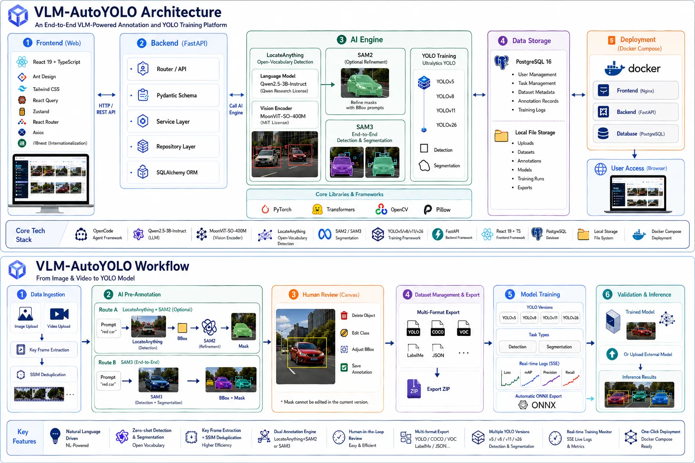
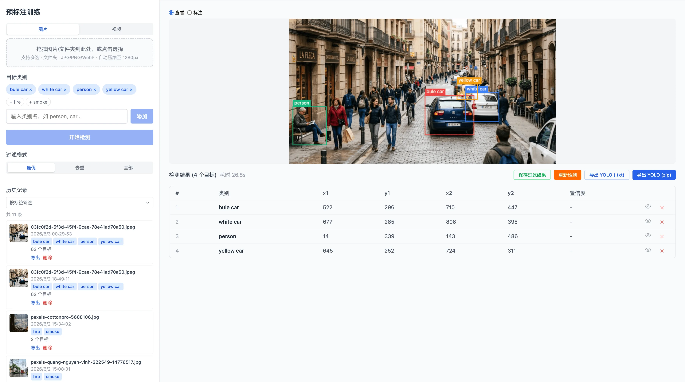
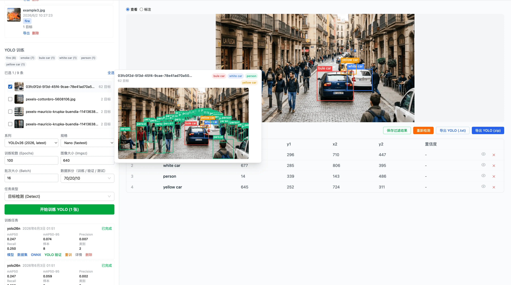
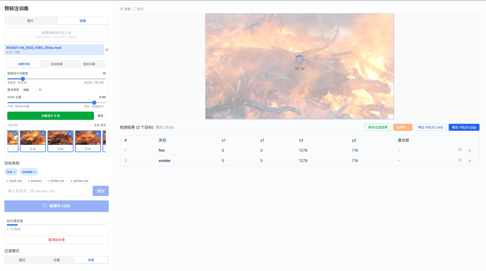
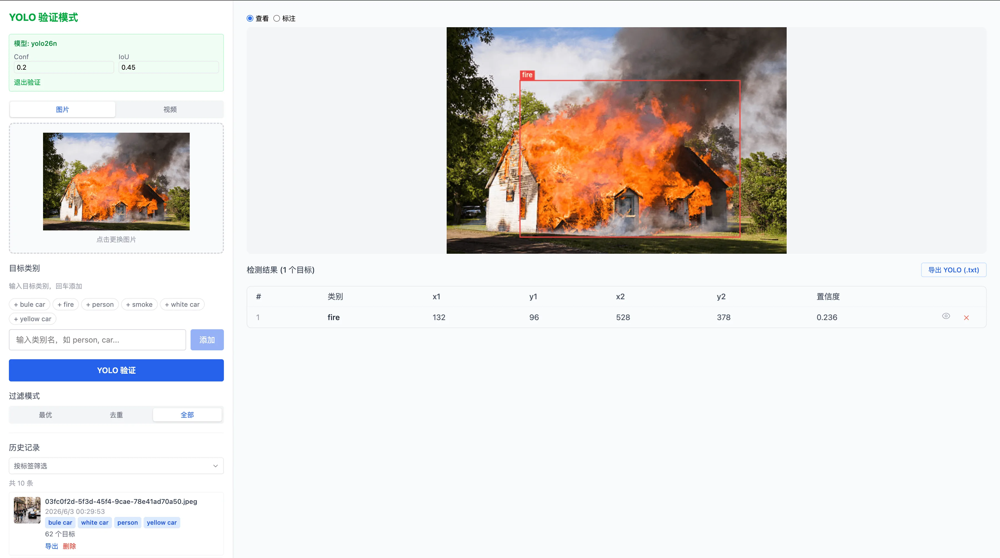

# VLM-AutoYOLO

[简体中文](README_ZH.md) | English

> ### 📌 Local deployment & customization edition (not the official upstream project)
>
> This repository is a **local deployment and customization fork** of
> **[Somnusochi/VLM-AutoYOLO](https://github.com/Somnusochi/VLM-AutoYOLO)** — an open-source
> "images/videos in → YOLO model out" auto-labeling workbench originally created by **Somnusochi**.
>
> - **Upstream project:** <https://github.com/Somnusochi/VLM-AutoYOLO> — base commit
>   [`a2240f1`](https://github.com/Somnusochi/VLM-AutoYOLO/commit/a2240f19681f5ac55bd5246d839691ca8a5ece46)
>   (`master`, 2026-09-22, v1.5.16-era). Original copyright and attribution remain with the upstream author.
> - **License:** [AGPL-3.0](LICENSE). The upstream `LICENSE` is preserved unchanged, and all local
>   modifications are released under the same license.
> - **What this fork adds:** a macOS Apple Silicon (MPS) local deployment verified end-to-end, a small
>   UI/workflow upgrade, and backend compatibility fixes (2026-11-11) — full list in
>   [Local Changes](#local-changes).
> - **Source-only repository:** model weights, ffmpeg binaries and runtime data are **not tracked**
>   (see [Repository Assets](#repository-assets-not-tracked)).
> - **Not official upstream:** for upstream releases, documentation and support, use the upstream
>   repository. Local-only changes are maintained by this fork, not by the upstream author.

<p align="center">
  
  
  
  
  
  
</p>

```
🖼️ image/video → 🔍 VLM / SAM3 detection → 🎯 SAM2/SAM3 mask → ✏️ refine → 📦 export → 🚀 YOLO → ✅ model
```

**Images or videos in → YOLO model out**, with VLM auto-labeling (LocateAnything-3B), SAM2.1 / SAM3 mask refinement, and human-in-the-loop correction. Multi-format export, one-click YOLO training (detect & segment), video keyframe extraction, and model validation — all GPU-accelerated on macOS MPS and Windows/Linux CUDA.



> See [Architecture & Workflow Documentation](docs/architecture_diagram_en.md) for detailed Mermaid diagrams.

## Local Changes

Upstream code is unchanged except for the following verified local modifications, applied on top of
upstream `master` @ `a2240f1`. The upstream `CHANGELOG.md` still describes the upstream lineage
(latest upstream release: v1.5.16); the changes below are this fork's additions.

### UI & workflow upgrade (2026-11-11)

- **One-click video preparation** — the video panel now has "extract keyframes & load" (「一键：抽帧并载入标注」)
  and "select all & load" actions. Keyframes go straight into the annotation queue, the UI switches to the
  **Image** tab, and the target-category field is highlighted, because detection cannot start without a category.
  `frontend/src/components/VideoPanel/index.tsx`, `frontend/src/components/VideoPanel/ExtractionPanel.tsx`,
  `frontend/src/components/Sidebar/index.tsx`, `frontend/src/components/Sidebar/DetectionControls.tsx`
- **Training candidate filter ("Video frames only")** — training data selection can be filtered to frames
  extracted from videos. *Select all* now applies only to the filtered result set instead of silently
  selecting every record in the database. `frontend/src/components/TrainingPanel/index.tsx`
- **YOLO validation model dropdown fix** — the validation panel shared the training list's query cache and
  could render an empty model dropdown; it now uses its own query key and lists completed training runs.
  `frontend/src/components/ModelSelector/index.tsx`
- **Annotated video export** — after video validation, a server-rendered MP4 with bounding boxes drawn on
  every frame (H.264) can be downloaded, alongside the existing MJPEG live view. New backend endpoint
  `POST /api/v1/train/jobs/{job_id}/export-video/{video_id}` (per-frame YOLO inference + H.264 encode).
  `backend/app/api/routes/predict.py`, `frontend/src/components/VideoValidator/index.tsx`,
  `frontend/src/services/api.ts`
- **Counts, filtering and error messages** — selected/loaded counters follow the active filter; the API
  error interceptor now reads the backend `{error: {code, message}}` envelope, so validation/training
  failures surface the real message instead of a generic error.
  `frontend/src/services/request.ts`, `frontend/src/i18n/locales/{en,zh,ja}.json`

### Backend compatibility & stability fixes

- **Chunked dataset import 422 fixed** — the dynamic route `POST /datasets/import/chunk/{upload_id}/{chunk_index}`
  was registered before `.../chunk/{upload_id}/complete` and shadowed it. The chunk route is now registered
  last, so the upload-complete step works. `backend/app/api/routes/import_dataset.py`
- **SQLite UUID handling** — new helper `to_uuid()` in `backend/app/core/ids.py`. The detection repository,
  export service, trainer and training queue normalize string IDs to `uuid.UUID` before querying, avoiding
  `ValueError` failures on the SQLite UUID column type.
  `backend/app/repositories/detection.py`, `backend/app/services/export.py`,
  `backend/app/services/trainer.py`, `backend/app/services/training_queue.py`
- **ONNX export 405 fixed** — the frontend downloads via `GET` while the backend only exposed `POST`;
  a `GET /train/jobs/{job_id}/export-onnx` alias was added. `backend/app/api/routes/train.py`
- **Training queue failure state** — an abnormal training subprocess exit now marks the job `failed` with
  the exit code in `error_message`, instead of `cancelled` (which could leave a stale "running" job).
  `backend/app/services/training_queue.py`
- **Robust loss parsing & pretrained-weight fallback** — `_loss_value()` handles dict / tensor / missing
  loss entries for `on_fit_epoch_end`; if `backend/pretrained/<variant>.pt` is missing, Ultralytics'
  automatic weight download is used as a fallback instead of failing the job.
  `backend/app/services/trainer.py`
- **Manual box IDs** — the add-boxes API now returns the created record ID, and the frontend uses that
  real database ID for manually drawn boxes instead of a client-side temporary ID.
  `backend/app/api/routes/detection.py`, `frontend/src/hooks/useDetectionAnnotation.ts`

### Deployment adaptation (verified on this machine)

| Item | This deployment |
|------|-----------------|
| Hardware / OS | Apple M4, 16 GB unified memory, macOS 26.6.2 |
| Acceleration | PyTorch 2.15.0, MPS (`torch.backends.mps.is_available() == True`), no CUDA |
| Database | zero-config SQLite at `backend/autolabeling.db` (PostgreSQL not used) |
| Backend / frontend ports | 8010 / 5190 (8000 / 5173 were occupied; `start.sh` auto-selects free ports) |
| Model source | ModelScope (`nv-community/LocateAnything-3B`, `facebook/sam2.1-hiera-base-plus`) — no HF token required |
| Python / Node | Python 3.12 venv (created with `uv`), Node 24 + pnpm |

Verified locally: VLM container loaded (7.66 GB weights) and first detection after load took ~24.4 s;
VLM+SAM2 joint detection took ~8.0 s; no out-of-memory errors at 16 GB. The 2026-11-11 UI changes were
checked with `tsc --noEmit` and a manual pass (30 s video → 30 keyframes → VLM detection 20.2 s; annotated
MP4 export 768×432, 53.9 s clip, 1.63 MB; validation dropdown listing completed YOLO models). Existing
image detection, SAM2, keyframe extraction, training and MJPEG paths were left intact.

### Dependency changes

- `backend/requirements.txt` adds the ONNX export stack: `onnx>=1.12.0,<2.0.0`, `onnxruntime`,
  `onnxslim>=0.1.82`. No other dependency changes.

## Repository Assets (Not Tracked)

The Git repository contains **source code only** (~261 files, <10 MB). To run it, the following large or
machine-local assets must be provided locally; they are excluded via `.gitignore`:

| Asset | Local location (ignored) | Size in this deployment | Notes |
|-------|--------------------------|-------------------------|-------|
| VLM weights | `backend/model/` | ~7.66 GB (39 files) | LocateAnything-3B; required for VLM detection |
| SAM 2.1 checkpoint | `backend/pretrained/sam2.1-hiera-base-plus/sam2.1_hiera_base_plus.pt` | ~324 MB | optional local checkpoint; otherwise resolved from the HF cache |
| YOLO pretrained weights | `backend/pretrained/*.pt` | varies | Ultralytics downloads automatically when missing |
| ffmpeg / ffprobe | `bin/ffmpeg`, `bin/ffprobe` | ~61 MB | needed for video features; may also be installed system-wide |
| Demo images | `test_images/` | ~31 MB | sample images for trying the workflow |
| Runtime state | `backend/autolabeling.db`, `backend/uploads/`, `backend/training_runs/`, `backend/trained_models/`, `backend/import_progress/`, `backend/import_chunks/`, `runs/` | — | created at runtime; never committed |
| Python / Node envs | `backend/.venv/`, `frontend/node_modules/`, `frontend/dist/` | — | install locally |
| Env file | `backend/.env` | — | create from `backend/.env.example` |

### First-run model downloads

```bash
# VLM weights — ModelScope (no Hugging Face token required; source used by this deployment)
modelscope download --model nv-community/LocateAnything-3B \
  --local_dir backend/model --exclude "assets/*" --max-workers 8

# SAM 2.1 checkpoint — ModelScope
modelscope download --model facebook/sam2.1-hiera-base-plus \
  --include sam2.1_hiera_base_plus.pt \
  --local_dir backend/pretrained/sam2.1-hiera-base-plus
```

Then point the backend at the checkpoint (only needed when using a manually downloaded SAM2 file):

```bash
# backend/.env
SAM2_CHECKPOINT_PATH=/absolute/path/to/backend/pretrained/sam2.1-hiera-base-plus/sam2.1_hiera_base_plus.pt
```

Hugging Face alternative (upstream default):

```bash
huggingface-cli download nvidia/LocateAnything-3B --local-dir backend/model
python -c "from sam2.build_sam import build_sam2_hf; build_sam2_hf('facebook/sam2.1-hiera-base-plus', device='cpu')"
```

### ffmpeg / ffprobe

Video keyframe extraction and video validation need `ffmpeg` (and `ffprobe`) on `PATH`:

```bash
brew install ffmpeg          # macOS
# or use local static binaries and export them for the backend:
export PATH="$PWD/bin:$PATH"
./start.sh
```

`bin/` is not added to `PATH` automatically — `cli.py` checks `ffmpeg` with `shutil.which()`, so either
install ffmpeg system-wide or export `PATH` as shown above before starting the backend.

## Key Features

- 🤖 **VLM auto-labeling**: Open-vocabulary object detection with LocateAnything-3B
- 🎯 **SAM2 / SAM3 segmentation**: Bbox → pixel-precise mask with SAM 2.1 or SAM3 text-driven detection+segmentation in one pass, BBox/Mask toggle on canvas
- 🎥 **Video annotation**: Intelligent keyframe extraction (scene / motion / interval), SSIM dedup, one-click keyframe → annotation queue
- ✏️ **Manual refinement**: Canvas draw mode, NMS filtering, hide/show individual boxes
- 📦 **Multi-format export/import**: YOLO, YOLO-Seg, COCO JSON, Pascal VOC XML, CreateML JSON — export all saved detections or selected records as ZIP, import datasets via chunked upload (max 10GB, resume support)
- 🚀 **Training queue**: Sequential job processing with cancel support, one-click training (YOLOv8 / v11 / v26) with real-time SSE progress
- ✅ **Model validation**: Batch image / video testing, MJPEG live stream, SSE video inference, annotated MP4 export
- 💾 **Smart model management**: Lazy loading, idle auto-unload, MPS/CUDA strategy pattern cleanup
- 🌐 **i18n**: English / 简体中文 / 日本語 · 🎨 **Theme**: Light / dark mode

## Documentation

📚 **[User Guide (English)](docs/guide/en/README.md)** | 📚 **[用户指南 (中文)](docs/guide/README.md)**

Comprehensive guides: quick start, annotation best practices, training parameter tuning, model deployment.

## Screenshots

| VLM Pre-annotation & Refinement | YOLO Training |
|--------------------------------|---------------|
|  |  |

| Video Keyframe Entry | Model Validation |
|---------------------|-----------------|
|  |  |

## Tech Stack

| Layer | Technology |
|-------|-----------|
| Visual Grounding | NVIDIA LocateAnything-3B (Qwen2.5-3B + MoonViT) |
| Segmentation | SAM 2.1 / SAM3 — Segment Anything Model 2 / 3 |
| Object Detection | YOLOv8 / v11 / v26 — Detect & Segment (Ultralytics) |
| Backend | Python FastAPI + SQLite (default) / PostgreSQL + SSE |
| Frontend | React + TypeScript + Vite + Tailwind CSS + antd |
| GPU Memory | Strategy Pattern (`gpu_memory.py`) — CUDA expandable segments / MPS synchronize + empty_cache |
| State | Zustand + TanStack Query + ahooks |
| i18n | i18next (English / 简体中文 / 日本語) |
| Video | ffmpeg (scene / motion / interval extraction) |
| Tooling | pnpm, ESLint, Prettier, Husky, commitlint, Playwright |

## Quick Start

### CLI (Recommended for macOS / Linux / Windows)

```bash
git clone https://github.com/RylinXX/VLM-AutoYOLO.git
cd VLM-AutoYOLO
python3 cli.py all
```

The CLI handles everything: dependency checks, Python venv, pip install, pnpm install, database migrations, and launches both services. Open the frontend URL printed by the CLI (default http://localhost:5173).

On Windows, the CLI recognizes the `pnpm.cmd` and `npm.cmd` shims installed by Node.js and invokes them through the command interpreter, so `python cli.py all` works from PowerShell or CMD.

**Commands:**
```bash
python3 cli.py all                       # Setup + download models + start
python3 cli.py all --no-models           # Skip model download
python3 cli.py all --models=vlm          # Only download VLM model
python3 cli.py all --models=vlm,sam2     # Download VLM + SAM2
python3 cli.py setup                     # Install deps + init DB
python3 cli.py start                     # Launch services
python3 cli.py stop                      # Stop services
python3 cli.py status                    # Check if running
python3 cli.py download --models=vlm     # Re-download specific model
```

### Docker Deployment

> **Requirements:** Linux or Windows (WSL2) with NVIDIA GPU + [NVIDIA Container Toolkit](https://docs.nvidia.com/datacenter/cloud-native/container-toolkit/latest/install-guide.html).
> **macOS is not supported** — Docker on Mac has no GPU passthrough. Use [Manual Setup](#manual-setup) instead.

> **Note:** `docker-compose.yml` retains the upstream pre-built image names (`ghcr.io/somnusochi/...`).
> Those images contain **upstream** code, not this fork's local changes. To run this fork's code, build
> from source: `docker compose up -d --build`.

**Quick start with pre-built images (upstream code):**

```bash
curl -O https://raw.githubusercontent.com/RylinXX/VLM-AutoYOLO/main/docker-compose.yml
docker compose up -d
open http://localhost        # Frontend
open http://localhost:8000/docs  # API docs
```

**Build from source (recommended for this fork):**

```bash
git clone https://github.com/RylinXX/VLM-AutoYOLO.git
cd VLM-AutoYOLO
docker compose up -d --build
```

**Services:**

| Service | Port | Description |
|---------|------|-------------|
| Frontend | 80 | React web UI (Nginx) |
| Backend | 8000 | FastAPI server |
| SAM3 | 8002 | SAM3 standalone inference service |
| Database | 5432 | PostgreSQL |

**GPU Support** — `docker-compose.yml` has built-in GPU passthrough configured. No manual editing required.

**Persistent Storage (Docker volumes):**
- `pgdata` — Database · `model-cache` — VLM model · `sam3-cache` — Hugging Face cache for SAM2/SAM3 · `uploads` — User images/videos · `training-data` — YOLO training outputs

**Backup / Restore:**

```bash
docker compose exec db pg_dump -U postgres autolabeling > backup.sql
cat backup.sql | docker compose exec -T db psql -U postgres autolabeling
```

### Manual Setup

**Requirements:**

| Resource | Minimum | Recommended |
|----------|---------|-------------|
| Python | 3.12+ | 3.12+ |
| Node.js | 22+ | 22+ |
| Database | SQLite (zero-config) | PostgreSQL 16+ (optional) |
| ffmpeg | Any (with ffprobe) | — |
| macOS | Apple Silicon 16GB | 24GB+ |
| NVIDIA GPU | 12GB VRAM | 16GB+ |

**Setup:**

```bash
git clone https://github.com/RylinXX/VLM-AutoYOLO.git
cd VLM-AutoYOLO

# Backend
cd backend
python3 -m venv .venv
source .venv/bin/activate  # Windows: .venv\Scripts\activate
pip install -r requirements.txt
cd ..

# Frontend
cd frontend
pnpm install
cd ..

# Database (SQLite is the zero-config default; PostgreSQL is optional)
# If using PostgreSQL:
# psql -d postgres -c "CREATE DATABASE autolabeling;"
# cp backend/.env.example backend/.env   # then set DATABASE_URL
# If you prefer the zero-setup SQLite database, just skip the two steps above. The system will auto-generate autolabeling.db

# Optional local env (device, CORS origins, SAM2 checkpoint path):
# cp backend/.env.example backend/.env

# Migrations
cd backend
PYTHONPATH=. alembic upgrade head
```

**Pre-download models (optional):**

See [Repository Assets](#repository-assets-not-tracked) for the ModelScope commands used by this
deployment, or use the Hugging Face commands below.

```bash
huggingface-cli download nvidia/LocateAnything-3B --local-dir backend/model
python -c "from sam2.build_sam import build_sam2_hf; build_sam2_hf('facebook/sam2.1-hiera-base-plus', device='cpu')"
```

**Launch:**

```bash
./start.sh   # macOS / Linux — auto-selects free ports
start.bat    # Windows
```

| Service | URL |
|---------|-----|
| Frontend | http://localhost:5173 (or the port printed by `start.sh`) |
| Backend | http://localhost:8000 (or the port printed by `start.sh`) |
| API Docs | http://localhost:8000/docs |

**macOS (Apple Silicon) notes:**

```bash
cp backend/.env.example backend/.env   # DEVICE=mps; optional SAM2_CHECKPOINT_PATH / CORS_ORIGINS
./start.sh
# non-default ports (used by this deployment because 8000/5173 were occupied):
BACKEND_PORT=8010 FRONTEND_PORT=5190 ./start.sh
```

If the frontend port differs from 5173 and the browser talks to the backend directly, add that origin
to `CORS_ORIGINS` in `backend/.env` (the Vite dev server proxies `/api` by default, so this is only
needed for direct calls).

## Project Structure

Full directory tree: **[docs/STRUCTURE.md](docs/STRUCTURE.md)**

## Features

### VLM Pre-annotation

Upload images or video keyframes with open-vocabulary descriptions (e.g. `fire, smoke`, `red car`). LocateAnything-3B automatically detects and draws bounding boxes.

- Open-vocabulary natural language descriptions
- Auto-resize by long-side cap (VRAM-based: 800–1333px)
- Batch upload folders or video keyframes, streaming results

### SAM2 Segmentation

Enable SAM2 (Segment Anything Model 2) to refine VLM bounding boxes into pixel-precise masks.

- Check "Enable SAM2 Segmentation" before detection — runs automatically after VLM
- SAM 2.1 model (base+), lazy-loaded with idle auto-unload
- Score threshold slider for mask quality filtering
- Masks rendered as semi-transparent overlays on canvas
- BBox and Mask independently toggled on both main canvas and hover preview
- Result table shows polygon vertex count per box

### SAM3 Detection + Segmentation

Switch to SAM3 mode for text-driven detection and segmentation in a single pass — no VLM required.

- Toggle between VLM+SAM2 and SAM3 via the model selector in the sidebar
- Enter open-vocabulary text prompts (e.g. `cat`, `red car`) — SAM3 detects and segments all matching instances
- **Confidence threshold** slider (0.0–1.0, default 0.5) controls detection sensitivity
- **Mask threshold** slider (0.0–1.0, default 0.5) controls mask tightness
- Enable/disable segmentation independently — bbox-only mode skips mask extraction for faster results
- SAM3 runs as a standalone HTTP service on port 8002 with its own venv (`backend/sam3-venv/`)
- **Requires `HF_TOKEN`** — set this env var before starting the backend. Two steps:
  1. Open [huggingface.co/facebook/sam3](https://huggingface.co/facebook/sam3) in browser, click **"Agree and access repository"**
  2. Create a **Read** token at [huggingface.co/settings/tokens](https://huggingface.co/settings/tokens) (no need for Fine-grained — a plain Read token inherits your account's permissions)
  Model cached in `~/.cache/huggingface/hub/` after first download
- Auto-starts on first use, idle auto-unload after 10 min
- Real-time loading status via SSE (`starting` → `loading` → `loaded`)
- Manual unload button to free GPU memory
- Backend auto-switches: using SAM3 unloads VLM/SAM2, and vice versa
- Detection records tagged with `model_type` (VLM / VLM+SAM2 / SAM3) for traceability

### Video Annotation

Upload a video, extract keyframes, select and batch-annotate.

- **Three extraction modes**: scene change, motion detection (optical flow), fixed interval
- **SSIM deduplication**: auto-removes near-duplicate frames
- **Timeline preview**: horizontal scrollable strip, click for full-size view
- **Multi-select**: check frames, select/cancel all, load to annotation queue
- **One-click preparation**: extract keyframes and load them for annotation in a single action; the UI then switches to the Image tab with the category field highlighted

### Manual Annotation

Canvas-based annotation with View / Draw modes.

- Category quick-fill from history
- VLM pre-annotation baseline → delete mistakes → draw missing boxes
- All / Best / NMS filter modes, settings saved per detection
- Hide individual boxes while inspecting dense results
- Per-frame re-detection

### History Management

- Thumbnail + category tag previews, tag-based multi-select filtering
- Click to view details, re-detect with updated labels, virtual scroll with infinite loading
- Single / batch / full-history export in **5 formats**: YOLO, YOLO-Seg, COCO JSON, Pascal VOC XML, CreateML JSON
- Format selection via dropdown menu, one-click zip download

### YOLO Training

- **Series**: YOLOv8 / v11 / v26 (n/s/m/l/x)
- **Task types**: Object Detection (Detect), Instance Segmentation (Segment)
- Segmentation training auto-uses SAM2 polygon labels; falls back to bbox when unavailable
- Tag filter + thumbnail preview for precise data selection
- **"Video frames only" filter** — restrict training candidates to video-extracted keyframes; select-all respects the active filter
- Virtual scroll with "Load All" button for large datasets
- Dataset split presets (70/20/10, 80/20, 90/10, 60/20/20)
- Real-time SSE progress: Epoch / Loss / mAP50
- Rename training jobs for easier identification
- Auto ONNX export; download PT / ONNX / dataset zip

### Model Validation

- **Dual source**: trained models or externally uploaded `.pt` files
- **Conf / IoU sliders** for real-time threshold tuning
- **Batch image validation** with bounding boxes and confidence scores
- **Video validation** (three modes):
  - MJPEG live stream with interactive play/pause
  - SSE prediction stream with per-frame JSON events
  - Sync batch prediction — all frames at once
- **Annotated video export** — save boxed frames as an H.264 MP4 (server-side)
- Temporary results; export predictions as YOLO `.txt` files

### Model Management

- **Lazy loading**: VLM, SAM2, and SAM3 load on first use, unload after idle (default 10 min)
- **Idle watchdog**: all three models auto-unload after `MODEL_IDLE_TIMEOUT_SECONDS` of inactivity
- **Unified SSE status**: `GET /api/v1/model/events` streams VLM, SAM2, SAM3 status in one connection
- **Manual unload**: each model has its own unload button and API endpoint
- **GPU memory**: Strategy Pattern (`gpu_memory.py`) — CUDA `expandable_segments` / MPS `synchronize`+`empty_cache`+`gc`
- **Transparent load errors**: model load/inference failures are returned to the UI instead of being hidden behind generic detection errors

### Troubleshooting: Stuck at `Loading to GPU`

If the VLM model stays at `Loading to GPU`, the model files were already found and the failure is likely happening while PyTorch moves LocateAnything-3B onto CUDA/MPS. The UI now surfaces the backend error directly, so check the toast message or backend logs for the real cause, such as CUDA OOM, missing NVIDIA runtime, driver mismatch, or a dependency import error.

Useful Docker checks:

```bash
docker compose logs backend --tail=200
docker compose exec backend python - <<'PY'
import torch
print("cuda:", torch.cuda.is_available())
print("device:", torch.cuda.get_device_name(0) if torch.cuda.is_available() else None)
print("mem:", torch.cuda.mem_get_info() if torch.cuda.is_available() else None)
PY
nvidia-smi
```

## API Reference

Full API documentation with request/response examples: **[docs/API.md](docs/API.md)**

The local-only addition is documented in [Local Changes](#local-changes):
`POST /api/v1/train/jobs/{job_id}/export-video/{video_id}`.

## Cross-Platform

| Platform | Inference | Training |
|----------|-----------|----------|
| macOS (Apple Silicon) | MPS | MPS |
| Linux / Windows (NVIDIA) | CUDA | CUDA |

Auto-detection: CUDA → MPS. Override via `DEVICE` env. **CPU not supported.**

## Inference Benchmarks

### Upstream reference

Tested locally on an **Apple MacBook Pro (M4 Pro, 24GB Unified Memory)** using Apple MPS hardware acceleration.

| Image Resolution (Max Side) | Inference Latency | Actual Memory Footprint |
| :--- | :--- | :--- |
| **Thumbnail (256px)** | `~0.68s` | Stable around `~11.8GB` |
| **High-Res (1024px)** | `~4.35s` | Stable around `~11.8GB` |

Full detailed benchmarks across different hardware configurations: **[docs/BENCHMARKS.md](docs/BENCHMARKS.md)**

### This local deployment (Apple M4, 16GB, MPS)

| Measurement | Result |
| :--- | :--- |
| VLM weights loaded | ~7.66 GB (39 files), loaded successfully |
| First detection after load (cold start) | ~24.4 s |
| VLM + SAM2 joint detection | ~8.0 s |
| Peak memory | no OOM at 16 GB unified memory |
| 30 s video → 30 keyframes → VLM detection | 20.2 s (UI one-click flow) |
| Annotated video export | 768×432 H.264, 53.9 s clip → 1.63 MB |

## Highlights

- **MPS / CUDA full-pipeline GPU acceleration** — VLM, SAM2, and YOLO training all GPU-accelerated
- **Strategy Pattern GPU memory** — `gpu_memory.py` centralizes CUDA / MPS cleanup; `expandable_segments:True`
- **SAM2 / SAM3 mask refinement** — SAM2 refines VLM bboxes; SAM3 does text-driven detection+segmentation in one pass
- **5 export formats** — YOLO, YOLO-Seg, COCO, Pascal VOC, CreateML; export selected records or the full detection history
- **Detect & Segment training** — polygon labels auto-used when SAM2 masks are available
- **Cross-platform** — macOS MPS, Windows / Linux CUDA, unified codebase
- **Unified SSE model status** — single EventSource for VLM, SAM2, SAM3 states; no polling

## Development

```bash
# Frontend
cd frontend && pnpm install && pnpm run lint && pnpm run build

# Backend
cd backend && source .venv/bin/activate
PYTHONPATH=. alembic upgrade head
python -m compileall app alembic
```

## License

Original project: [Somnusochi/VLM-AutoYOLO](https://github.com/Somnusochi/VLM-AutoYOLO), [AGPL-3.0](LICENSE).
The upstream `LICENSE` is preserved unchanged; local modifications in this repository are released
under the same AGPL-3.0 license. Upstream copyright and attribution remain with their original authors.

Third-party dependencies:
- LocateAnything-3B model — [NVIDIA License](https://huggingface.co/nvidia/LocateAnything-3B/blob/main/LICENSE) (non-commercial use only)
- SAM3 model — [Facebook Research License](https://huggingface.co/facebook/sam3) (gated repository, requires HuggingFace access token)
- Ultralytics YOLO — [AGPL-3.0](https://github.com/ultralytics/ultralytics/blob/main/LICENSE) (copyleft; training/deployment may trigger obligations)
