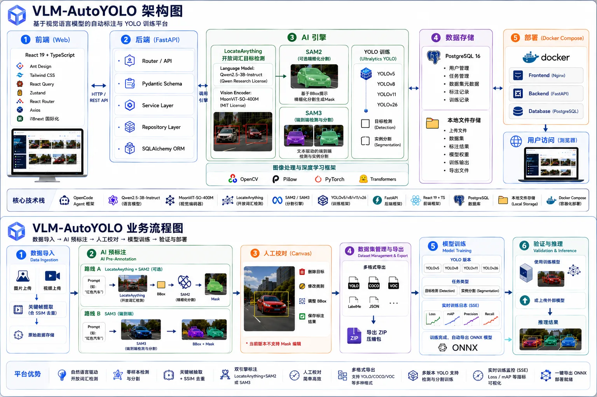
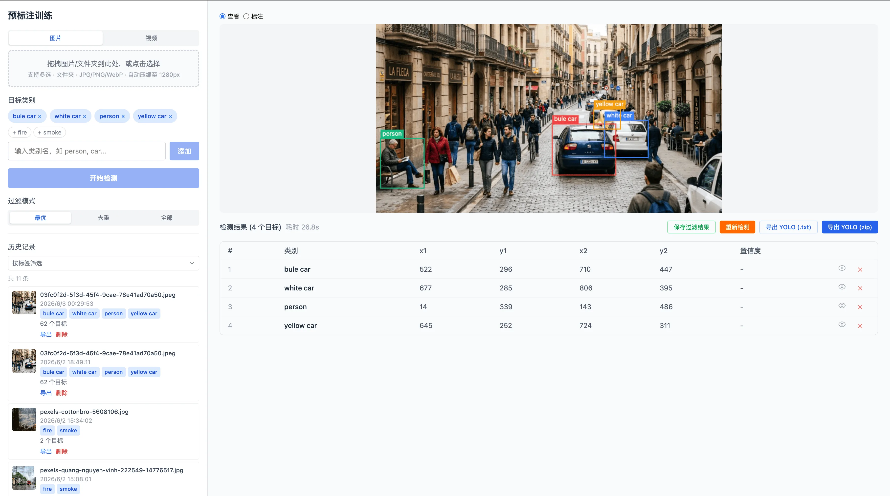
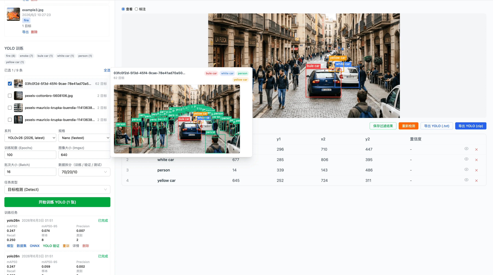
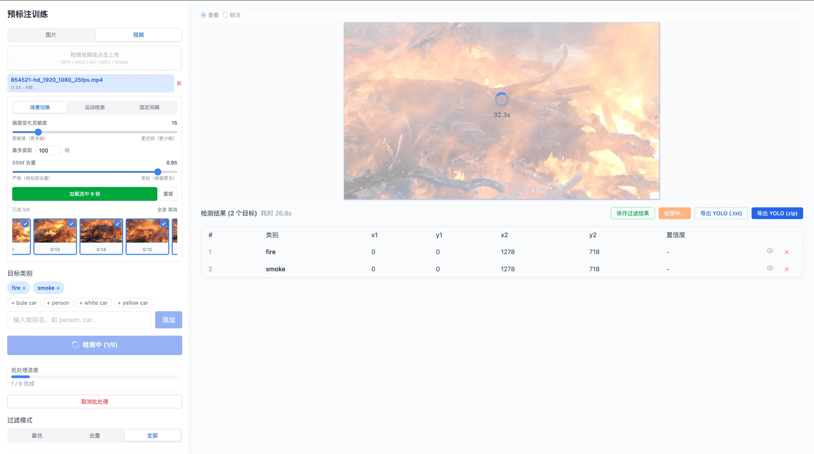
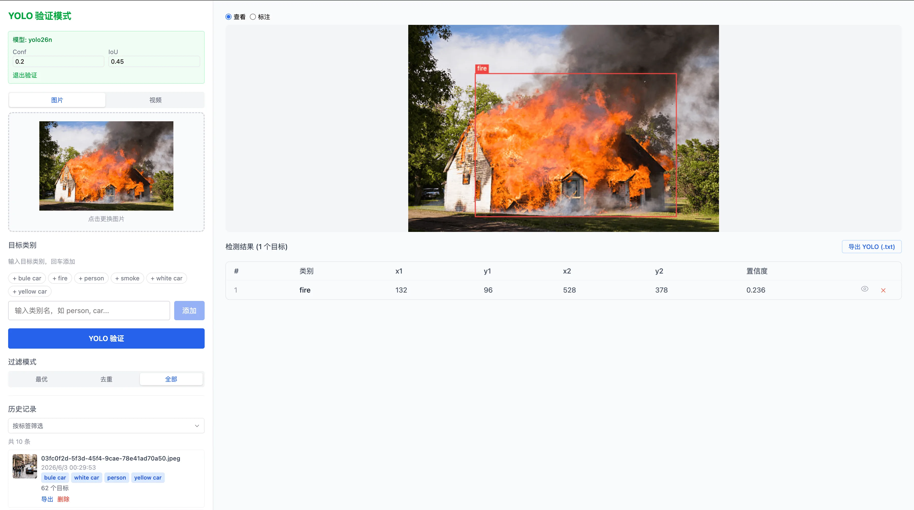

# VLM-AutoYOLO

[English](README.md) | 简体中文

> ### 📌 本地部署与改造版（非上游官方项目）
>
> 本仓库是 **[Somnusochi/VLM-AutoYOLO](https://github.com/Somnusochi/VLM-AutoYOLO)** 的**本地部署与改造分支**。
> 上游是一个「图片/视频进 → YOLO 模型出」的开源自动标注工作台，原作者为 **Somnusochi**。
>
> - **上游项目：** <https://github.com/Somnusochi/VLM-AutoYOLO> — 基于 `master` 分支
>   [`a2240f1`](https://github.com/Somnusochi/VLM-AutoYOLO/commit/a2240f19681f5ac55bd5246d839691ca8a5ece46)
>   （2026-09-22，v1.5.16 时期）。原始版权与署名归上游作者所有。
> - **许可证：** [AGPL-3.0](LICENSE)。上游 `LICENSE` 原样保留，本仓库的本地修改同样以 AGPL-3.0 发布。
> - **本分支增加的内容：** 一套经过端到端验证的 macOS Apple Silicon（MPS）本地部署方案、一次小型 UI/工作流升级，
>   以及若干后端兼容性修复（2026-11-11）——完整清单见 [本地改造](#本地改造)。
> - **纯源码仓库：** 模型权重、ffmpeg 二进制和运行时数据**不纳入版本管理**，
>   见 [仓库资产说明](#仓库资产说明不纳入-git)。
> - **非上游官方：** 上游版本、文档与支持请访问上游仓库；本地改动由本分支维护，不属于上游作者的责任范围。

<p align="center">
  
  
  
  
  
  
</p>

```
🖼️ 图片/视频 → 🔍 VLM / SAM3 检测 → 🎯 SAM2/SAM3 分割 → ✏️ 修正 → 📦 导出 → 🚀 YOLO → ✅ 模型
```

**图片/视频扔进去 → YOLO 模型训出来**，基于 LocateAnything-3B 的 VLM 自动标注 + SAM2.1 / SAM3 mask 精修 + 人工闭环修正。多格式数据集导入导出、训练任务队列、一键 YOLO 训练（检测 & 分割）、视频关键帧提取、模型验证——macOS MPS / Windows & Linux CUDA 全链路 GPU 加速。



> 详细 Mermaid 图表请查看 [架构与流程文档](docs/architecture_diagram.md)

## 本地改造

上游代码除以下经 diff 核对确认的本地修改外保持不变，修改基于上游 `master` @ `a2240f1`。
上游 `CHANGELOG.md` 仍记录上游版本历史（最新上游版本为 v1.5.16），本地改动均列在本节。

### UI / 工作流升级（2026-11-11）

- **视频一键准备** — 视频面板新增「一键：抽帧并载入标注」和「全选并载入」。关键帧抽取后直接进入标注队列，
  界面自动切到**图片**标签页并高亮目标类别输入框（没有类别无法开始检测）。
  `frontend/src/components/VideoPanel/index.tsx`、`frontend/src/components/VideoPanel/ExtractionPanel.tsx`、
  `frontend/src/components/Sidebar/index.tsx`、`frontend/src/components/Sidebar/DetectionControls.tsx`
- **训练候选筛选（「仅视频帧」）** — 训练数据选择可只保留视频抽取的关键帧；「全选」只作用于筛选结果，
  不再把数据库里的全部记录一起选中。`frontend/src/components/TrainingPanel/index.tsx`
- **验证模型下拉框修复** — 验证面板与训练列表共用查询缓存，可能导致模型下拉框为空；现在使用独立的 query key，
  可正常列出已完成的训练任务。`frontend/src/components/ModelSelector/index.tsx`
- **导出带框视频** — 视频验证后除 MJPEG 实时预览外，可下载服务端渲染的逐帧带框 MP4（H.264）。
  新增后端接口 `POST /api/v1/train/jobs/{job_id}/export-video/{video_id}`（逐帧 YOLO 推理 + H.264 编码）。
  `backend/app/api/routes/predict.py`、`frontend/src/components/VideoValidator/index.tsx`、
  `frontend/src/services/api.ts`
- **计数、筛选与错误信息** — 已选/已载入数量随当前筛选条件变化；API 错误拦截器识别后端
  `{error: {code, message}}` 信封，验证/训练失败时显示真实错误信息。
  `frontend/src/services/request.ts`、`frontend/src/i18n/locales/{en,zh,ja}.json`

### 后端兼容性与稳定性修复

- **分片数据集导入 422 修复** — 动态路由 `POST /datasets/import/chunk/{upload_id}/{chunk_index}` 注册在
  `.../chunk/{upload_id}/complete` 之前，导致 complete 被遮蔽。现将分片路由调整到最后注册，上传完成步骤恢复正常。
  `backend/app/api/routes/import_dataset.py`
- **SQLite UUID 处理** — 新增 `to_uuid()` 辅助函数（`backend/app/core/ids.py`）。检测仓储、导出服务、
  训练器与训练队列在查询前把字符串 ID 规范化为 `uuid.UUID`，避免 SQLite 的 UUID 列类型抛 `ValueError`。
  `backend/app/repositories/detection.py`、`backend/app/services/export.py`、
  `backend/app/services/trainer.py`、`backend/app/services/training_queue.py`
- **ONNX 导出 405 修复** — 前端以 `GET` 下载，后端只有 `POST`；新增
  `GET /train/jobs/{job_id}/export-onnx` 别名。`backend/app/api/routes/train.py`
- **训练队列失败状态** — 训练子进程异常退出时把任务标记为 `failed`，并在 `error_message` 中记录退出码；
  原先标记为 `cancelled`，可能留下一直显示「运行中」的僵死任务。`backend/app/services/training_queue.py`
- **Loss 解析与预训练权重兜底** — `_loss_value()` 兼容 dict / tensor / 缺失的 loss 项，用于
  `on_fit_epoch_end`；当 `backend/pretrained/<variant>.pt` 不存在时回退到 Ultralytics 自动下载权重，
  不再直接失败。`backend/app/services/trainer.py`
- **手动框 ID** — 新增边界框接口现在返回记录创建后的真实 ID，前端手动画框使用该 ID，
  不再用客户端临时 ID。`backend/app/api/routes/detection.py`、`frontend/src/hooks/useDetectionAnnotation.ts`

### 部署适配（本机实测）

| 项目 | 本部署实例 |
|------|-----------|
| 硬件 / 系统 | Apple M4，16GB 统一内存，macOS 26.6.2 |
| 加速后端 | PyTorch 2.15.0，MPS（`torch.backends.mps.is_available() == True`），无 CUDA |
| 数据库 | 零配置 SQLite：`backend/autolabeling.db`（未使用 PostgreSQL） |
| 前后端端口 | 8010 / 5190（8000 / 5173 被占用；`start.sh` 会自动选择空闲端口） |
| 模型来源 | ModelScope（`nv-community/LocateAnything-3B`、`facebook/sam2.1-hiera-base-plus`），无需 HF Token |
| Python / Node | Python 3.12 venv（用 `uv` 创建），Node 24 + pnpm |

本机验证结果：VLM 容器加载成功（7.66GB 权重），加载后首次检测约 24.4s；VLM+SAM2 联合检测约 8.0s；
16GB 内存未出现 OOM。2026-11-11 的 UI 改动通过 `tsc --noEmit` 检查，并做了人工回归（30s 视频 → 30 张关键帧
→ VLM 检测 20.2s；带框 MP4 导出 768×432、53.9s 视频、1.63MB；验证下拉框可列出已完成训练的 YOLO 模型）。
原有图片检测、SAM2、抽帧、训练与 MJPEG 链路保持不变。

### 依赖调整

- `backend/requirements.txt` 增加 ONNX 导出依赖：`onnx>=1.12.0,<2.0.0`、`onnxruntime`、`onnxslim>=0.1.82`。
  其余依赖不变。

## 仓库资产说明（不纳入 Git）

本仓库只包含**源码**（约 261 个文件，不到 10MB）。运行还需要以下体积较大或与本机相关的资产，
它们已通过 `.gitignore` 排除：

| 资产 | 本地位置（已忽略） | 本部署中的大小 | 说明 |
|------|------------------|--------------|------|
| VLM 权重 | `backend/model/` | 约 7.66GB（39 个文件） | LocateAnything-3B，VLM 检测必需 |
| SAM 2.1 权重 | `backend/pretrained/sam2.1-hiera-base-plus/sam2.1_hiera_base_plus.pt` | 约 324MB | 可选本地 checkpoint；否则从 HF 缓存解析 |
| YOLO 预训练权重 | `backend/pretrained/*.pt` | 视模型而定 | 缺失时 Ultralytics 自动下载 |
| ffmpeg / ffprobe | `bin/ffmpeg`、`bin/ffprobe` | 约 61MB | 视频功能必需，也可以装到系统 PATH |
| 示例图片 | `test_images/` | 约 31MB | 试用工作流的示例图 |
| 运行时数据 | `backend/autolabeling.db`、`backend/uploads/`、`backend/training_runs/`、`backend/trained_models/`、`backend/import_progress/`、`backend/import_chunks/`、`runs/` | — | 运行时生成，不提交 |
| Python / Node 环境 | `backend/.venv/`、`frontend/node_modules/`、`frontend/dist/` | — | 本地安装 |
| 环境变量文件 | `backend/.env` | — | 从 `backend/.env.example` 复制 |

### 首次运行：下载模型

```bash
# VLM 权重 — ModelScope（无需 Hugging Face Token；本部署使用的下载方式）
modelscope download --model nv-community/LocateAnything-3B \
  --local_dir backend/model --exclude "assets/*" --max-workers 8

# SAM 2.1 权重 — ModelScope
modelscope download --model facebook/sam2.1-hiera-base-plus \
  --include sam2.1_hiera_base_plus.pt \
  --local_dir backend/pretrained/sam2.1-hiera-base-plus
```

然后让后端指向该 checkpoint（仅在使用手动下载的 SAM2 文件时需要）：

```bash
# backend/.env
SAM2_CHECKPOINT_PATH=/absolute/path/to/backend/pretrained/sam2.1-hiera-base-plus/sam2.1_hiera_base_plus.pt
```

Hugging Face 方式（上游默认）：

```bash
huggingface-cli download nvidia/LocateAnything-3B --local-dir backend/model
python -c "from sam2.build_sam import build_sam2_hf; build_sam2_hf('facebook/sam2.1-hiera-base-plus', device='cpu')"
```

### ffmpeg / ffprobe

视频关键帧提取和视频验证需要 `PATH` 中有 `ffmpeg`（以及 `ffprobe`）：

```bash
brew install ffmpeg          # macOS
# 或使用本地静态二进制，为后端临时加入 PATH：
export PATH="$PWD/bin:$PATH"
./start.sh
```

`bin/` 不会被自动加入 `PATH` —— `cli.py` 通过 `shutil.which()` 检查 `ffmpeg`，
因此请把 ffmpeg 安装到系统 PATH，或按上面的方式在启动后端前 export PATH。

## 核心功能

- 🤖 **VLM 自动标注**：基于 LocateAnything-3B 的开放词汇目标检测
- 🎯 **SAM2 / SAM3 分割**：SAM2 精修 VLM 检测框；SAM3 文本驱动的端到端检测+分割，BBox/Mask 画布独立开关
- 🎥 **视频标注**：智能关键帧提取（场景/运动/间隔），SSIM 去重，一键关键帧 → 标注队列
- ✏️ **人工修正**：Canvas 画框模式，NMS 过滤，单框隐藏
- 📦 **多格式导入/导出**：YOLO、YOLO-Seg、COCO JSON、Pascal VOC XML、CreateML JSON — 支持全量或选中检测记录导出 ZIP，分片上传支持最大 10GB、断点续传
- 🚀 **训练队列**：任务排队串行执行，支持取消，一键 YOLO 训练（v8 / v11 / v26）SSE 实时进度
- ✅ **模型验证**：批量图片/视频测试，MJPEG 实时流，SSE 视频推理，带框视频导出
- 💾 **智能模型管理**：VLM/SAM2/SAM3 惰性加载，闲置自动卸载，统一 SSE 状态推送，MPS/CUDA 策略模式内存回收
- 🌐 **国际化**：中文 / English / 日本語 · 🎨 **主题**：亮色/暗色模式

## 文档

📚 **[用户指南 (中文)](docs/guide/README.md)** | 📚 **[User Guide (English)](docs/guide/en/README.md)**

完整指南：快速开始、标注最佳实践、训练参数调优、模型部署。

## 截图

| VLM 预标注与人工修正 | YOLO 训练 |
|------------------|-----------|
|  |  |

| 视频关键帧入口 | 模型验证 |
|--------------|---------|
|  |  |

## 技术栈

| 层 | 技术 |
|---|------|
| 视觉定位 | NVIDIA LocateAnything-3B（Qwen2.5-3B + MoonViT） |
| 分割精修 | SAM 2.1 / SAM3 — Segment Anything Model 2 / 3 |
| 目标检测 | YOLOv8 / v11 / v26 — 检测 & 分割（Ultralytics） |
| 后端 | Python FastAPI + SQLite（默认）/ PostgreSQL + SSE |
| 前端 | React + TypeScript + Vite + Tailwind CSS + antd |
| GPU 内存 | 策略模式（`gpu_memory.py`）— CUDA expandable segments / MPS synchronize + empty_cache |
| 状态管理 | Zustand + TanStack Query + ahooks |
| 国际化 | i18next（中文 / 英文 / 日本語） |
| 视频处理 | ffmpeg（场景检测 / 运动检测 / 间隔提取） |
| 工程化 | pnpm、ESLint、Prettier、Husky、commitlint、Playwright |

## 快速开始

### CLI（推荐 macOS / Linux / Windows）

```bash
git clone https://github.com/RylinXX/VLM-AutoYOLO.git
cd VLM-AutoYOLO
python3 cli.py all
```

CLI 自动处理所有环境准备：依赖检查、Python venv、pip install、pnpm install、数据库迁移，然后启动前后端。
浏览器打开 CLI 输出的前端地址（默认 http://localhost:5173）。

Windows 下 CLI 会自动识别 Node.js 安装的 `pnpm.cmd` / `npm.cmd`，并通过命令解释器调用，因此在 PowerShell 或 CMD 中执行 `python cli.py all` 均可正常安装依赖。

**命令：**
```bash
python3 cli.py all                       # 安装依赖 + 下载模型 + 启动
python3 cli.py all --no-models           # 跳过模型下载
python3 cli.py all --models=vlm          # 只下载 VLM 模型
python3 cli.py all --models=vlm,sam2     # 下载 VLM + SAM2
python3 cli.py setup                     # 安装依赖 + 初始化数据库
python3 cli.py start                     # 启动服务
python3 cli.py stop                      # 停止服务
python3 cli.py status                    # 查看运行状态
python3 cli.py download --models=vlm     # 重新下载指定模型
```

### Docker 部署

> **环境要求：** Linux 或 Windows (WSL2) + NVIDIA GPU + [NVIDIA Container Toolkit](https://docs.nvidia.com/datacenter/cloud-native/container-toolkit/latest/install-guide.html)。
> **macOS 不支持** — Docker on Mac 无 GPU 直通，请使用[手动安装](#手动安装)。

> **注意：** `docker-compose.yml` 保留上游的预构建镜像名（`ghcr.io/somnusochi/...`）。
> 这些镜像包含的是**上游代码**，不包含本分支的本地改动。要运行本分支代码，请从源码构建：
> `docker compose up -d --build`。

**使用预构建镜像（上游代码）：**

```bash
curl -O https://raw.githubusercontent.com/RylinXX/VLM-AutoYOLO/main/docker-compose.yml
docker compose up -d
open http://localhost        # 前端
open http://localhost:8000/docs  # API 文档
```

**从源码构建（本分支推荐）：**

```bash
git clone https://github.com/RylinXX/VLM-AutoYOLO.git
cd VLM-AutoYOLO
docker compose up -d --build
```

**服务：**

| 服务 | 端口 | 说明 |
|------|------|------|
| 前端 | 80 | React 界面（Nginx） |
| 后端 | 8000 | FastAPI 服务器 |
| SAM3 | 8002 | SAM3 独立推理服务 |
| 数据库 | 5432 | PostgreSQL |

**GPU 支持** — `docker-compose.yml` 内置 GPU 直通配置，直接拉起即可，无需手动修改配置。

**持久化存储（Docker 卷）：**
- `pgdata` — 数据库 · `model-cache` — VLM 模型 · `sam3-cache` — SAM2/SAM3 使用的 Hugging Face 缓存 · `uploads` — 用户上传 · `training-data` — 训练输出

**备份/恢复：**

```bash
docker compose exec db pg_dump -U postgres autolabeling > backup.sql
cat backup.sql | docker compose exec -T db psql -U postgres autolabeling
```

### 手动安装

**环境要求：**

| 资源 | 最低配置 | 推荐配置 |
|------|---------|---------|
| Python | 3.12+ | 3.12+ |
| Node.js | 22+ | 22+ |
| 数据库 | SQLite（零配置） | PostgreSQL 16+（可选） |
| ffmpeg | 任意版本（含 ffprobe） | — |
| macOS | Apple Silicon 16GB | 24GB+ |
| NVIDIA GPU | 12GB 显存 | 16GB+ |

**安装：**

```bash
git clone https://github.com/RylinXX/VLM-AutoYOLO.git
cd VLM-AutoYOLO

# 后端
cd backend
python3 -m venv .venv
source .venv/bin/activate  # Windows: .venv\Scripts\activate
pip install -r requirements.txt
cd ..

# 前端
cd frontend
pnpm install
cd ..

# 数据库（默认零配置 SQLite；PostgreSQL 为可选项）
# 如果使用 PostgreSQL:
# psql -d postgres -c "CREATE DATABASE autolabeling;"
# cp backend/.env.example backend/.env   # 然后设置 DATABASE_URL
# 如果你想使用免安装的 SQLite 本地数据库，直接跳过上方两步，系统会自动生成 autolabeling.db

# 可选：本地环境变量（设备、CORS 来源、SAM2 checkpoint 路径）
# cp backend/.env.example backend/.env

# 迁移
cd backend
PYTHONPATH=. alembic upgrade head
```

**预下载模型（可选）：**

本部署使用的 ModelScope 命令见 [仓库资产说明](#仓库资产说明不纳入-git)，也可以使用下面的 Hugging Face 方式。

```bash
huggingface-cli download nvidia/LocateAnything-3B --local-dir backend/model
python -c "from sam2.build_sam import build_sam2_hf; build_sam2_hf('facebook/sam2.1-hiera-base-plus', device='cpu')"
```

**启动：**

```bash
./start.sh   # macOS / Linux — 自动选择空闲端口
start.bat    # Windows
```

| 服务 | 地址 |
|------|------|
| 前端 | http://localhost:5173（或 `start.sh` 打印的端口） |
| 后端 | http://localhost:8000（或 `start.sh` 打印的端口） |
| API 文档 | http://localhost:8000/docs |

**macOS（Apple Silicon）说明：**

```bash
cp backend/.env.example backend/.env   # DEVICE=mps；可选 SAM2_CHECKPOINT_PATH / CORS_ORIGINS
./start.sh
# 非默认端口（本部署因 8000/5173 被占用而使用 8010/5190）：
BACKEND_PORT=8010 FRONTEND_PORT=5190 ./start.sh
```

如果前端端口不是 5173，且浏览器需要直连后端，请把该来源加入 `backend/.env` 的 `CORS_ORIGINS`
（Vite 开发服务器默认代理 `/api`，只有直连后端时才需要调整）。

## 项目结构

完整目录树：**[docs/STRUCTURE_ZH.md](docs/STRUCTURE_ZH.md)**

## 功能

### VLM 预标注

上传图片或视频关键帧，输入开放词汇描述（如 `fire, smoke`、`红色汽车`），LocateAnything-3B 自动检测并绘制边界框。

- 开放词汇自然语言描述
- 按长边自动缩放（根据 VRAM：800–1333px）
- 批量上传文件夹或视频关键帧，流式返回

### SAM2 分割

VLM 检测出 bbox 后，可启用 SAM2 自动生成像素级 mask 轮廓。

- 勾选「启用 SAM2 分割」后自动运行
- SAM 2.1 模型（base+），惰性加载，闲置自动卸载
- 评分阈值滑块控制 mask 质量过滤
- mask 半透明叠加在画布上，bbox 和 mask 独立开关
- 结果表格显示每个目标的 mask 顶点数，预览浮窗同步渲染

### SAM3 检测 + 分割

切换到 SAM3 模式实现文本驱动的端到端检测与分割——无需 VLM。

- 通过侧边栏模型选择器在 VLM+SAM2 和 SAM3 之间切换
- 输入开放词汇文本提示（如 `猫`、`红色汽车`），SAM3 自动检测并分割所有匹配实例
- **置信度阈值**滑块（0.0–1.0，默认 0.5）控制检测灵敏度
- **Mask 阈值**滑块（0.0–1.0，默认 0.5）控制 mask 紧致度
- 可独立开关分割：纯检测模式跳过 mask 提取，更快出结果
- SAM3 作为独立 HTTP 服务运行在 8002 端口，使用独立虚拟环境（`backend/sam3-venv/`）
- **需要 `HF_TOKEN` 环境变量**——启动后端前设置，分两步：
  1. 浏览器打开 [huggingface.co/facebook/sam3](https://huggingface.co/facebook/sam3)，点击 **"Agree and access repository"** 同意协议
  2. 在 [huggingface.co/settings/tokens](https://huggingface.co/settings/tokens) 创建一个 **Read** 类型 Token（无需 Fine-grained，普通 Read Token 自动继承账号权限）
  首次下载后模型缓存在 `~/.cache/huggingface/hub/`
- 首次使用时自动启动，闲置 10 分钟后自动卸载
- SSE 实时加载状态（`starting` → `loading` → `loaded`）
- 手动卸载按钮释放 GPU 内存
- 后端自动互斥：使用 SAM3 时卸载 VLM/SAM2，反之亦然
- 检测记录标注模型类型（VLM / VLM+SAM2 / SAM3）

### 视频标注

上传视频，智能提取关键帧，挑选后批量标注。

- **三种提取方式**：场景切换、运动检测（光流法）、固定间隔
- **SSIM 去重**：自动去除相似帧
- **时间轴预览**：水平滑动浏览，点击放大
- **多选机制**：勾选帧、全选/取消全选、加载到标注队列
- **一键准备**：抽帧并载入标注一步完成，随后自动切到图片标签页并高亮目标类别输入框

### 手动标注

Canvas 画框模式，查看/标注双模式切换。

- 历史类别快速填充
- VLM 预标注打底 → 删错框 → 补漏框
- 全部 / 最优 / NMS 去重过滤，设置可保存
- 临时隐藏单框，密集检测结果检查
- 单帧重新检测

### 历史管理

- 缩略图 + 类别标签，按标签多选筛选
- 点击查看详情，支持重新检测，虚拟滚动 + 无限加载
- 单张/批量/全量历史导出 **5 种格式**：YOLO、YOLO-Seg、COCO JSON、Pascal VOC XML、CreateML JSON
- 下拉菜单选格式，一键下载 zip

### YOLO 训练

- **系列**：YOLOv8 / v11 / v26（n/s/m/l/x）
- **任务类型**：目标检测（Detect）、实例分割（Segment）
- 分割训练自动使用 SAM2 polygon 标签，无 polygon 时 fallback 到 bbox
- 标签筛选 + 缩略图预览精确选择训练数据
- **「仅视频帧」筛选** — 训练候选只保留视频抽取的关键帧；「全选」只作用于当前筛选结果
- 虚拟滚动 + 「加载全部」按钮，大数据集无卡顿
- 训练任务支持重命名，便于辨识
- 数据集拆分预设（70/20/10、80/20、90/10、60/20/20）
- SSE 实时推送：Epoch / Loss / mAP50
- 自动 ONNX 导出，可下载 PT / ONNX / 数据集 zip

### 模型验证

- **双模型源**：训练模型或外部上传 `.pt` 文件
- **Conf / IoU 滑块**实时调节阈值
- **图片批量验证**，显示边界框和置信度
- **视频验证**（三种模式）：
  - MJPEG 实时流，支持交互式暂停
  - SSE 预测流，逐帧 JSON 事件
  - 同步批量预测，一次性返回全部结果
- **导出带框视频** — 将逐帧带框结果保存为 H.264 MP4（服务端渲染）
- 临时结果，可导出 YOLO `.txt` 标注

### 模型管理

- **惰性加载**：VLM、SAM2、SAM3 首次使用自动加载，闲置超时自动卸载（默认 10 分钟）
- **闲置看门狗**：三个模型均有 watchdog，通过 `MODEL_IDLE_TIMEOUT_SECONDS` 配置
- **统一 SSE 状态**：`GET /api/v1/model/events` 单连接推送三模型状态，前端不再轮询
- **手动卸载**：每个模型均有独立卸载按钮和 API 端点
- **GPU 内存**：策略模式（`gpu_memory.py`）— CUDA `expandable_segments` / MPS `synchronize`+`empty_cache`+`gc`
- **透明加载错误**：模型加载/推理失败会把真实后端错误返回前端，不再只显示笼统的检测失败

### 排查：卡在 `加载到 GPU`

如果 VLM 一直停在 `加载到 GPU`，通常说明模型文件已经被找到，问题发生在 PyTorch 将 LocateAnything-3B 搬到 CUDA/MPS 的阶段。前端会直接显示后端真实错误，请优先查看 toast 或后端日志，常见原因包括 CUDA OOM、NVIDIA runtime 未透传、驱动/runtime 不匹配，或依赖导入失败。

Docker 环境可先检查：

```bash
docker compose logs backend --tail=200
docker compose exec backend python - <<'PY'
import torch
print("cuda:", torch.cuda.is_available())
print("device:", torch.cuda.get_device_name(0) if torch.cuda.is_available() else None)
print("mem:", torch.cuda.mem_get_info() if torch.cuda.is_available() else None)
PY
nvidia-smi
```

## API 概览

完整 API 文档与请求/响应示例：**[docs/API_ZH.md](docs/API_ZH.md)**

本地新增接口见 [本地改造](#本地改造)：`POST /api/v1/train/jobs/{job_id}/export-video/{video_id}`。

## 跨平台

| 平台 | 推理后端 | 训练后端 |
|------|---------|---------|
| macOS (Apple Silicon) | MPS | MPS |
| Linux / Windows (NVIDIA) | CUDA | CUDA |

自动检测：CUDA → MPS。可通过 `DEVICE` 环境变量覆盖。**不支持 CPU。**

## 推理性能基准

### 上游参考数据

以下是在 **Apple MacBook Pro (M4 Pro, 24GB 统一内存)** 上开启 Apple MPS 硬件加速后的上游实测数据：

| 图像分辨率 (长边最大值) | 推理耗时 (Latency) | 真实总内存占用 (活动监视器) |
| :--- | :--- | :--- |
| **缩略图 (256px)** | `~0.68s` | 稳压在 `~11.8GB` |
| **高清大图 (1024px)** | `~4.35s` | 稳压在 `~11.8GB` |

完整且更详细的多硬件环境基准测试请查阅：**[docs/BENCHMARKS_ZH.md](docs/BENCHMARKS_ZH.md)**

### 本部署实测（Apple M4，16GB，MPS）

| 指标 | 结果 |
| :--- | :--- |
| VLM 权重加载 | 约 7.66GB（39 个文件），加载成功 |
| 加载后首次检测（冷启动） | 约 24.4s |
| VLM + SAM2 联合检测 | 约 8.0s |
| 峰值内存 | 16GB 统一内存下未 OOM |
| 30s 视频 → 30 张关键帧 → VLM 检测 | 20.2s（UI 一键流程） |
| 带框视频导出 | 768×432 H.264，53.9s 视频 → 1.63MB |

## 项目亮点

- **MPS / CUDA 全链路 GPU 加速** — VLM 推理、SAM2 分割、YOLO 训练均跑 GPU
- **策略模式 GPU 内存管理** — `gpu_memory.py` 统一 CUDA / MPS 清理；`expandable_segments:True`
- **SAM2 / SAM3 mask 精修** — SAM2 精修 VLM bbox；SAM3 文本驱动端到端检测+分割
- **5 种导出格式** — YOLO、YOLO-Seg、COCO、Pascal VOC、CreateML；支持选中记录或全部检测历史导出
- **检测 & 分割训练** — SAM2 polygon 标签自动用于分割训练
- **跨平台** — macOS MPS、Windows / Linux CUDA，统一代码库
- **统一 SSE 模型状态** — 单连接推送 VLM / SAM2 / SAM3 状态，无需轮询

## 开发与校验

```bash
# 前端
cd frontend && pnpm install && pnpm run lint && pnpm run build

# 后端
cd backend && source .venv/bin/activate
PYTHONPATH=. alembic upgrade head
python -m compileall app alembic
```

## License

原始项目：[Somnusochi/VLM-AutoYOLO](https://github.com/Somnusochi/VLM-AutoYOLO)，[AGPL-3.0](LICENSE)。
上游 `LICENSE` 原样保留；本仓库的本地修改同样以 AGPL-3.0 发布。原始版权与署名归上游作者所有。

第三方依赖协议：
- LocateAnything-3B 模型 — [NVIDIA License](https://huggingface.co/nvidia/LocateAnything-3B/blob/main/LICENSE)（非商用）
- SAM3 模型 — [Facebook Research License](https://huggingface.co/facebook/sam3)（gated 仓库，需要 HuggingFace 访问 Token）
- Ultralytics YOLO — [AGPL-3.0](https://github.com/ultralytics/ultralytics/blob/main/LICENSE)（copyleft，训练/部署可能触发开源义务）
